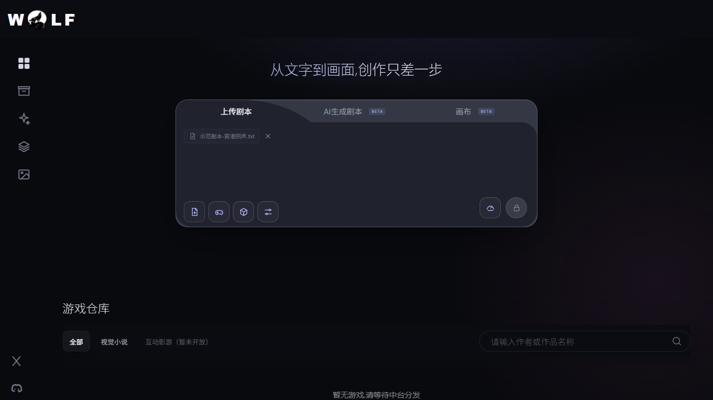

<div align="center">

# VNStory

### 把一部小说，变成一部可游玩的视觉小说

从 TXT 原稿开始，自动完成剧情分析、角色与场景设计、视觉素材生成、游戏构建和浏览器预览。

<p>
  <strong>AI 创作 · 分支叙事 · 视觉素材 · 一键预览</strong>
</p>

</div>

<p align="center">
  
</p>

> VNStory 当前以本地视觉生产模式为主：无需登录、无需 OSS、无需 Harbor，适合快速验证从文本到视觉小说的完整链路。

## 为什么是 VNStory

传统视觉小说制作需要在剧本、分支、角色立绘、场景图和游戏引擎之间反复切换。VNStory 把这些步骤串成一条可恢复的生产流水线，让创作者可以专注于故事本身：

- **从文字开始**：上传 TXT 小说，自动读取章节并建立任务。
- **让故事结构化**：提取人物、关系、地点、世界观、时间线和关键事件。
- **让选择真正产生后果**：设计分支、变量、选项效果和结局，并在发布前校验拓扑。
- **保持视觉一致**：基于角色设定生成角色图、背景、场景和 CG。
- **直接看到成品**：构建游戏包，在浏览器中阅读章节和对白。
- **支持中断恢复**：阶段状态、checkpoint、产物哈希和失败原因都会被记录。

## 你可以用它做什么

| 场景 | VNStory 提供的能力 |
| --- | --- |
| 小说改编 | 将长篇 TXT 转成章节、对白和可交互的故事节点 |
| 互动叙事 | 创建选择、变量、分支路线和多结局 |
| 视觉预演 | 快速生成角色、场景、背景和 CG 资产 |
| 创作协作 | 用结构化产物、manifest 和审核结果交接任务 |
| 本地演示 | 无需登录，在浏览器中预览已构建的视觉小说 |

## 工作流


完整阶段说明见 [VISUAL_NOVEL_PIPELINE.md](VISUAL_NOVEL_PIPELINE.md)。

## 快速开始

### 环境要求

- Windows 10/11
- Docker Desktop，启用 Linux containers
- 可用的本机 PostgreSQL：`localhost:15432`
- PostgreSQL 数据库：`agent_platform`
- Docker Compose 使用的数据库账号：`platform / platform`
- 用于剧情或图片生成的模型 API Key（按实际启用的服务配置）

> [!IMPORTANT]
> 当前 Compose 不创建 PostgreSQL。启动前请先确认本机数据库已运行，并且 `agent_platform` 数据库可连接。

### 1. 获取代码并准备配置

```powershell
git clone https://github.com/shimingming520/VN-Game.git
cd VN-Game\novel-game-factory
Copy-Item .env.example .env
```

编辑 `.env`，至少根据所使用的模型服务填写对应 API Key，例如：

```dotenv
GPT_IMAGE_API_KEY=your_api_key
DASHSCOPE_API_KEY=your_api_key
```

真实 `.env`、密钥、模型权重和本地生成产物不会提交到 Git。

### 2. 启动本地视觉生产链

```powershell
docker compose -f docker-compose.yml -f docker-compose.local.yml up -d
```

查看服务状态：

```powershell
docker compose -f docker-compose.yml -f docker-compose.local.yml ps
```

### 3. 打开应用

| 地址 | 用途 |
| --- | --- |
| [http://localhost:5174](http://localhost:5174) | 创作前端：上传小说、查看任务和游戏仓库 |
| [http://localhost:8000/health](http://localhost:8000/health) | API Gateway 健康检查 |
| [http://localhost:8088](http://localhost:8088) | 游戏预览服务 |

健康检查返回以下内容即可继续：

```json
{"status":"healthy"}
```

停止服务：

```powershell
docker compose -f docker-compose.yml -f docker-compose.local.yml down
```

> 当前 `docker-compose.local.yml` 中包含 Windows 本机路径挂载。如果把项目移动到其他目录，请同步修改 `storage` 的宿主机路径。

## 从小说到游戏

1. 在创作前端上传 `.txt` 小说。
2. API Gateway 将原文保存到 `storage/raw_novels` 并创建任务。
3. `story_planner` 分析章节、人物、世界观和剧情结构。
4. `info_extractor` 提取角色、场景和可用素材信息。
5. `char_designer` 与 `scene_painter` 生成视觉资产。
6. `game_builder` 生成可访问的游戏包。
7. `game_server` 提供浏览器预览，前端游戏仓库展示已完成作品。

任务产物通常位于：

```text
storage/
├── raw_novels/              # 上传的原文和章节中间产物
├── outputs/<task_id>/       # 剧情树、素材和 manifest
└── built_games/<task_id>/   # 可浏览器预览的游戏包
```

## 项目结构

```text
VNStory/
├── creation-engine-frontend/  # 创作前端：Vue 3 + Vite
├── novel-game-factory/        # 本地视觉生产链和游戏构建服务
├── game-platform/             # 任务编排、平台 API 和中台前端
├── creation-engine/           # 旧版创作网关和兼容接口
├── observability/             # Loki、Vector、Grafana 等观测配置
├── skills/                    # 视觉小说生产阶段的契约与工作流
├── storage/                   # 本地运行时数据，不纳入版本控制
├── VISUAL_NOVEL_PIPELINE.md   # 完整生产流程与验收标准
└── VNSTORY_PROJECT_MEMORY.md  # 本地运行约束和排障记录
```

### 核心服务

| 服务 | 作用 |
| --- | --- |
| `api_gateway` | 接收上传、创建任务、返回任务状态 |
| `story_planner` | 小说预检查、剧情分析、章节和分支规划 |
| `info_extractor` | 提取人物、场景、世界观和素材信息 |
| `char_designer` | 生成角色设定与角色图片 |
| `scene_painter` | 生成背景、场景和 CG |
| `game_builder` | 将文本和素材构建为视觉小说游戏包 |
| `game_server` | 提供静态游戏资源和浏览器预览 |
| `redis` | Celery 任务队列和阶段调度 |

## 开发与验证

查看服务日志：

```powershell
docker compose -f docker-compose.yml -f docker-compose.local.yml logs -f api_gateway
```

检查关键接口：

```powershell
curl.exe -sS http://localhost:8000/health
curl.exe -i -sS http://localhost:5174/
curl.exe -i -sS http://localhost:5174/api/v1/models/options
```

运行 Python 测试：

```powershell
python -m pytest novel-game-factory/tests
```

运行中台前端测试：

```powershell
cd game-platform\frontend
npm ci
npm test
```

中台前端和 API 的独立联调说明见 [game-platform/README.md](game-platform/README.md)。

## 当前模式与边界

- 本地模式默认关闭登录验证，适合本机创作和演示。
- 本地模式禁用 OSS，文件写入宿主机 `storage`。
- 当前重点是“可阅读的视觉小说”，`audio_producer` 和 `sound_arranger` 在本地视觉模式中可以跳过。
- 当前游戏预览地址使用 `localhost`，适合当前电脑访问；局域网部署需要改为宿主机地址或统一配置。
- 生产部署仍需要补充真实的密钥管理、外部数据库、对象存储和访问控制。

## 文档导航

- [完整视觉小说生产流程](VISUAL_NOVEL_PIPELINE.md)
- [项目运行记忆与排障手册](VNSTORY_PROJECT_MEMORY.md)
- [输入预检查契约](skills/vn-input-preflight/SKILL.md)
- [剧情结构契约](skills/vn-story-structure/SKILL.md)
- [一致性审核契约](skills/vn-consistency-review/SKILL.md)
- [图片资产契约](skills/vn-image-generation/SKILL.md)
- [游戏构建与预览契约](skills/vn-build-preview/SKILL.md)
- [名称脱敏契约](skills/vn-name-anonymization/SKILL.md)
- [文本翻译契约](skills/vn-text-translation/SKILL.md)

## 贡献代码

欢迎提交 Issue、改进文档或提交 Pull Request。新增生产阶段时，请同时说明：

1. 阶段输入和输出；
2. 阻塞条件、失败和重试策略；
3. checkpoint、产物路径和 manifest；
4. 前端任务状态展示方式；
5. 对应的测试和验收标准。

提交前请确认没有包含 `.env`、API Key、数据库密码、模型权重、`node_modules` 或本地生成产物。