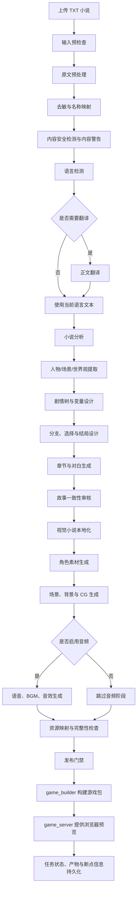

# VNStory 视觉小说完整生产流程

更新时间：2026-10-12

## 1. 文档目的

本文档记录 VNStory 从小说输入到视觉小说预览的完整生产流程，并区分：

- **完整业务流程**：平台在内容处理、剧情生产、本地化、素材生成、审核和发布阶段应覆盖的能力。
- **当前本地视觉模式**：当前 Docker Compose 本地链路已经启用的能力，以及被跳过或仍属于扩展能力的阶段。

当前项目的核心目标是：

```text
用户无需登录
  -> 上传 TXT 小说
  -> 完成文本处理和剧情生产
  -> 生成角色、场景和 CG 素材
  -> 构建视觉小说游戏包
  -> 在浏览器中预览章节和对白
```

## 2. 总体流程



## 3. 端到端阶段说明

### 3.1 上传与任务创建

输入：

- `.txt` 小说文件；
- 创作参数；
- 输出语言；
- 分支模式或改编范围；
- 可选的视觉风格和素材配置。

处理：

1. 前端提交 `multipart/form-data`。
2. API Gateway 将原始小说保存到 `storage/raw_novels`。
3. 创建 `novel_tasks` 任务记录。
4. 返回任务 ID，并进入摘要或本地视觉生产链。

主要入口：

```text
POST /api/v1/story/upload
creation-engine-frontend/src/api/modules/creation.js
```

### 3.2 输入预检查

预检查必须在昂贵的 LLM、翻译和素材生成之前执行。

检查内容：

- 文件是否存在；
- 文本编码是否可解析；
- 文本是否为空；
- 字符数是否超出限制；
- 章节数量是否合理；
- 是否存在明显损坏或格式异常；
- 是否需要切分为章节；
- 是否检测到源语言；
- 改编范围和输出语言是否有效。

主要模块：

```text
novel-game-factory/services/story_planner/core/novel_preflight.py
novel-game-factory/services/story_planner/core/novel_text_encoding.py
novel-game-factory/services/story_planner/core/novel_reader.py
```

门禁：

```text
预检查失败 -> 停止后续剧情生成，并返回明确错误
```

### 3.3 原文预处理

原文预处理只清理确定属于元信息的内容，不应改写正文剧情。

处理内容：

- 清理标题、作者、标签、字数、网址、连载状态等头部元信息；
- 识别并移除转载、翻译、校对、来源等署名信息；
- 保留首个正式章节标题；
- 保留正文顺序和原始叙事内容；
- 以 UTF-8 产出可复用的中间文本；
- 保存章节处理 checkpoint，支持任务中断后恢复。

当前实现中，头部清理会限制在文本开头的安全范围内，并使用边界锚点切片，避免模型直接重写正文。

### 3.4 去敏与名称映射

去敏阶段用于保护真实姓名、统一角色标识，并避免错误改写泛称。

处理内容：

- 真实人名替换；
- 姓名、别名、称谓的统一映射；
- 复合姓氏识别；
- 音译复合名和家族名处理；
- “姓氏 + 职业/关系词”处理；
- 保留“系统、旁白、司机、老师”等泛称；
- 将映射结果提供给剧情分析、提示词、对白、字幕和素材命名。

示例：

```text
王司机 -> 沈司机
张三 -> 顾言
司机 -> 司机
系统 -> 系统
```

重要原则：

- 去敏后的角色必须在全文中保持同一映射；
- 不能把泛称误改成人名；
- 机器字段、节点 ID、素材 ID 不参与人名替换；
- 若无法确认某个称呼是否为真实人名，应保留不确定性并进入审核。

主要模块：

```text
novel-game-factory/common/name_mapping_utils.py
novel-game-factory/common/generic_appellations.py
novel-game-factory/services/info_extractor/character/name_mappings.py
```

### 3.5 内容安全检测与内容警告

内容安全检测和去敏不是同一个模块：

- **去敏**解决姓名和身份信息暴露问题；
- **内容警告**识别玩家可能需要提前知道的敏感内容。

检测内容可包括：

- 暴力或身体伤害；
- 性相关内容；
- 未成年人相关敏感内容；
- 自伤、死亡、虐待等主题；
- 其他由规则或审核分类器定义的内容类别。

输出内容：

- 是否存在敏感内容；
- 敏感类别；
- 严重程度；
- 置信度；
- 涉及章节；
- 是否需要玩家确认；
- 各语言的警告标题、说明和确认按钮文案。

内容警告中的机器字段必须跨语言保持不变，例如：

```text
code
presence
severity
evidence_chapters
schema_version
```

玩家可见的标题、摘要、类别名称和确认文案才允许翻译。

主要模块：

```text
novel-game-factory/services/story_planner/core/content_warnings.py
novel-game-factory/tests/story_planner/test_content_warnings.py
```

### 3.6 语言检测与正文翻译

先检测小说源语言，再判断是否需要翻译：

```text
源语言 == 输出语言 -> 不翻译
源语言 != 输出语言 -> 翻译正文
```

翻译要求：

- 保留章节顺序；
- 保留角色身份和世界观事实；
- 保留段落边界和内容范围；
- 不翻译或修改机器字段；
- 不改变分支逻辑、变量值和结局条件；
- 记录源语言、目标语言和翻译状态；
- 翻译失败时必须明确记录失败原因，不应静默伪装成功。

当前正文翻译路径使用本地翻译模块：

```text
novel-game-factory/services/story_planner/batch_translate.py
novel-game-factory/services/story_planner/tasks.py
```

当前代码会根据源语言和目标语言判断是否需要翻译，并在翻译失败时保留原文继续处理，同时记录警告。生产环境如果要求强制目标语言，应将该警告升级为阻塞门禁。

### 3.7 小说分析

将处理后的文本转为结构化的 `NovelContext`。

提取内容：

- 人物身份、目标、秘密、能力、伤势和最终状态；
- 人物关系；
- 世界规则；
- 阵营；
- 关键地点；
- 关键事件；
- 时间线；
- 隐藏线索；
- 章节摘要；
- 叙事视角；
- 风格样本；
- 结局维度；
- 行为锚点。

主要模块：

```text
novel-game-factory/services/story_planner/core/world_analyst.py
novel-game-factory/services/story_planner/core/hierarchical_processing.py
novel-game-factory/services/story_planner/core/chapter_context.py
novel-game-factory/services/info_extractor
```

原则：

- 区分原文事实、解释和改编提案；
- 不把模型推测写成原作事实；
- 高影响事实应保留章节或场景证据；
- 分析失败时不能继续生成依赖该事实的分支。

### 3.8 剧情树、分支与变量设计

在生成章节正文前，先建立可验证的剧情拓扑。

需要定义：

- 根节点；
- 原始章节节点；
- 分支节点；
- 结局节点；
- 稳定的 `node_id`；
- 父子关系和跳转目标；
- 分支变量；
- 变量阈值；
- 选项效果；
- 合流策略；
- 终止状态。

必须验证：

- 节点 ID 唯一；
- 所有跳转目标存在；
- 只有一个根节点；
- 所有节点可达；
- 不存在非法循环；
- 原始章节不重复或遗漏；
- 结局节点为终止节点；
- 所有使用的变量已经声明；
- 选项效果和阈值类型正确。

主要模块：

```text
novel-game-factory/services/story_planner/core/branch_designer.py
novel-game-factory/services/story_planner/core/soft_branch.py
novel-game-factory/services/story_planner/core/effects_validator.py
novel-game-factory/services/story_planner/core/chapter_branch_runtime.py
```

门禁：

```text
剧情拓扑验证失败 -> 不得进入章节正文生成
```

### 3.9 章节、对白与结局生成

根据通过验证的节点计划逐节点生成：

- 章节正文；
- 场景边界；
- 角色对白；
- 旁白；
- 玩家选项；
- 选择效果；
- 角色状态变化；
- 场景状态变化；
- 章节结尾；
- 结局节点。

结局必须能由路线历史和状态变化推导出来，不能只因为模型“认为应该结束”就直接生成。

每个产物应保留：

- 节点 ID；
- 父节点或来源节点；
- 角色和说话人；
- 选项及效果；
- 当前状态；
- 生成版本；
- 内容哈希；
- checkpoint 信息。

主要模块：

```text
novel-game-factory/services/story_planner/core/story_generator.py
novel-game-factory/services/story_planner/core/ending_writer.py
novel-game-factory/services/story_planner/core/chapter_branch_artifacts.py
```

### 3.10 故事一致性审核

一致性审核是发布前门禁，不只是文本校对。

审核顺序：

1. 结构：ID、链接、根节点、可达性、循环、终止节点；
2. 原作事实：人物、关系、章节顺序、世界规则、不可逆事件；
3. 状态：生死、伤势、地点、时间线、变量、效果、阈值；
4. 因果：选择是否产生可见后果，结局是否由路线导致；
5. 表现：文本非空、说话人稳定、素材引用可解析、输出可读取。

审核结果：

```text
pass
warning
repair_required
regenerate_required
blocked
```

主要模块：

```text
novel-game-factory/services/story_planner/core/chapter_branch_quality.py
novel-game-factory/services/story_planner/core/chapter_branch_resume.py
novel-game-factory/tests/story_planner
```

### 3.11 视觉小说本地化

本地化与正文翻译不同。正文翻译处理故事文本；本地化处理玩家可见的故事树、UI、选项和内容警告。

可本地化内容：

- 书名；
- 作品简介；
- 章节标题；
- 章节摘要；
- 选择文本；
- 内容警告标题和说明；
- 确认、返回等 UI 文案；
- 字幕；
- 资源元数据。

必须保持不变的字段：

```text
node_id
id
depth
parent_id
child_id
branch_variable
effects_a
effects_b
asset_id
speaker_id
segment_id
```

本地化审核：

- 各语言节点集合一致；
- 各语言跳转结构一致；
- 选项行为和效果一致；
- 人名、称谓和术语遵循术语表；
- 译文没有空标题、空摘要或空选项；
- 文本长度适合 UI 和字幕区域；
- 未确定的术语被列入变更报告，而不是静默猜测。

当前本地化契约主要覆盖故事树元数据和语言包。完整章节 Markdown 和语音脚本的本地化仍需调用方提供对应内容管线。

主要模块：

```text
skills/vn-localization
novel-game-factory/services/story_planner/core/story_tree_player_localization.py
creation-engine-frontend/src/api/modules/translate.js
creation-engine/gateway/translate.py
```

### 3.12 角色、场景、背景和 CG 素材

素材生成必须使用已经审核通过的剧情节点和视觉设定。

角色素材：

- 角色身份；
- 外观和服装状态；
- 表情；
- 姿态；
- 构图；
- 透明背景；
- 角色身份连续性；
- 角色图片 manifest。

场景素材：

- 地点；
- 时间；
- 天气和光照；
- 场景事件；
- 角色位置；
- 构图；
- 与相邻节点的连续性；
- 背景或 CG 文件记录。

生成顺序：

```text
全局视觉风格
  -> 角色设计
  -> 场景/背景/CG 设计
  -> 视觉审核
  -> 资源记录和 manifest
```

主要服务：

```text
novel-game-factory/services/char_designer
novel-game-factory/services/scene_painter
```

主要产物：

```text
storage/outputs/<task_id>/images/characters
storage/outputs/<task_id>/images/backgrounds
storage/outputs/<task_id>/images/scenes
storage/outputs/<task_id>/images/cg
storage/outputs/<task_id>/manifests/character_image_manifest.json
```

### 3.13 音频生成

完整业务流程可以包括：

- 角色语音；
- 旁白；
- BGM；
- 环境声；
- 音效；
- 字幕和音频的时间对应关系；
- 音量、静音、淡入淡出和循环点。

音频需要单独审核：

- 发音；
- 说话人；
- 情绪；
- 清晰度；
- 削波和静音；
- 时间长度；
- BGM 是否遮挡对白；
- 场景和事件是否对应。

主要服务：

```text
novel-game-factory/services/audio_producer
novel-game-factory/services/sound_arranger
```

**当前本地视觉模式状态：**

```text
sound_arranger = 跳过
audio_producer = 跳过
```

因此当前本地预览的完成标准是“可阅读的视觉小说”，不是“包含完整语音和音效的发行版本”。

### 3.14 资源映射与集成

把已审核的文本、图片和音频引用映射到运行时可以解析的场景数据。

检查内容：

- 场景 ID 和节点 ID；
- 对话段 ID；
- 说话人 ID；
- 选项和跳转；
- 图片路径；
- 音频路径；
- 语言覆盖；
- 文件类型；
- 文件存在性；
- fallback 规则；
- 资源是否过期或重复。

重要限制：

- 当前项目已确认存在角色图片 manifest；
- 尚未确认所有图片、语音、BGM、音效共享一个统一 manifest；
- 不得凭空补写不存在的资源路径；
- 缺失资源必须进入审核结果。

主要契约：

```text
skills/vn-asset-integration
skills/vn-asset-integration/references/asset-manifest-contract.md
```

### 3.15 发布门禁与游戏构建

发布前必须确认：

- 所有节点都有内容；
- 所有跳转目标都存在；
- 所有变量和效果可解析；
- 所有必需的角色、场景和 CG 引用存在；
- 所有语言包结构一致；
- 内容警告已生成；
- 资源路径可访问；
- 产物校验通过；
- 失败或未完成节点没有被伪装成成功；
- 持久化写入成功。

通过发布门禁后：

```text
game_builder
  -> 物化章节字幕和场景数据
  -> 复制或引用本地素材
  -> 生成游戏包
  -> 写入 storage/built_games/<task_id>
  -> game_server 提供浏览器访问
```

主要服务：

```text
novel-game-factory/services/game_builder
novel-game-factory/services/game_server
```

### 3.16 持久化、断点恢复与任务状态

每个阶段都应记录：

- `pending`、`running`、`completed`、`failed` 状态；
- 错误原因；
- 尝试次数；
- 产物 ID；
- 产物路径；
- 内容哈希；
- checkpoint；
- 生成版本；
- 依赖关系。

恢复时：

- 只复用经过校验的完成产物；
- 哈希不一致时不能直接复用；
- 下游依赖发生变化时应失效并重新生成；
- 只重新生成受影响的节点和资源；
- 保留错误原因和历史尝试；
- 不能把中断节点直接标记为成功。

主要模块：

```text
novel-game-factory/services/story_planner/core/chapter_branch_checkpoint.py
novel-game-factory/services/story_planner/core/chapter_branch_resume.py
novel-game-factory/common/progress_utils.py
```

## 4. 当前本地视觉模式实际链路

当前 Docker Compose 本地模式的主链路是：

```text
creation-engine-frontend
  -> API Gateway
  -> storage/raw_novels
  -> novel_tasks
  -> Redis/Celery
  -> story_planner
  -> info_extractor
  -> char_designer
  -> scene_painter
  -> game_builder
  -> storage/built_games/<task_id>
  -> game_server
```

当前已确认：

| 阶段 | 当前状态 |
|---|---|
| 小说上传 | 已启用 |
| 本地存储 | 已启用 |
| 剧情解析 | 已启用 |
| 人物/场景信息提取 | 已启用 |
| 角色素材生成 | 已启用 |
| 场景素材生成 | 已启用 |
| 游戏包构建 | 已启用 |
| 浏览器预览 | 已启用 |
| 音频生成 | 当前本地模式跳过 |
| 远程 OSS | 禁用 |
| Harbor | 不使用 |
| 登录验证 | 当前本地模式关闭 |

去敏、内容警告、正文翻译和故事树本地化在代码和契约中存在，但需要根据具体任务参数和生产入口确认是否在当前一次本地任务中被触发。它们不能因为模块存在就默认视为每次任务都已执行。

## 5. 关键数据流与产物

```text
storage/
├─ raw_novels/
│  ├─ <task_id>.txt
│  ├─ <task_id>.source.txt
│  ├─ <task_id>.source.meta.json
│  └─ <task_id>.chapters.json
├─ outputs/
│  └─ <task_id>/
│     ├─ story_tree.json
│     ├─ name_mappings.json
│     ├─ name_replacements.json
│     ├─ sound.json
│     ├─ images/
│     │  ├─ characters/
│     │  ├─ backgrounds/
│     │  ├─ scenes/
│     │  └─ cg/
│     ├─ manifests/
│     │  └─ character_image_manifest.json
│     └─ reports/
└─ built_games/
   └─ <task_id>/
```

## 6. 服务与模块对应关系

| 阶段 | 主要服务或模块 | 主要职责 |
|---|---|---|
| 上传与任务 | `api_gateway`、`creation-engine-frontend` | 接收文件、创建任务 |
| 预检查 | `novel_preflight`、`novel_text_encoding` | 编码、格式、规模校验 |
| 原文清洗 | `novel_reader`、`story_planner/tasks.py` | 头部元信息和章节处理 |
| 去敏 | `name_mapping_utils`、`generic_appellations` | 人名和称谓映射 |
| 内容警告 | `content_warnings` | 敏感内容检测和警告 |
| 翻译 | `batch_translate`、`translate.py` | 正文或元数据翻译 |
| 剧情分析 | `world_analyst`、`hierarchical_processing` | 事实、人物、世界观分析 |
| 剧情结构 | `branch_designer`、`soft_branch` | 节点、变量、分支 |
| 章节生成 | `story_generator`、`ending_writer` | 正文、对白、结局 |
| 一致性审核 | `chapter_branch_quality`、`effects_validator` | 结构、事实、状态、因果 |
| 本地化 | `story_tree_player_localization` | 语言包和玩家可见文本 |
| 角色素材 | `char_designer` | 角色图和角色 manifest |
| 场景素材 | `scene_painter` | 背景、场景、CG |
| 音频素材 | `audio_producer`、`sound_arranger` | 语音、BGM、音效 |
| 资源集成 | `game_builder`、asset integration contract | 资源引用和运行时交付 |
| 构建预览 | `game_builder`、`game_server` | 游戏包和浏览器预览 |
| 状态恢复 | checkpoint、resume、progress utils | 断点、重试和任务状态 |

## 7. 完整性检查结果

### 7.1 已覆盖的流程项

- [x] 小说上传和任务创建
- [x] 文件存储和任务元数据
- [x] 编码、空文件和输入格式预检查
- [x] 头部元信息和转载署名清理
- [x] 章节处理 checkpoint
- [x] 人名脱敏和统一映射
- [x] 泛称识别，避免错误改名
- [x] 内容安全检测和内容警告
- [x] 源语言检测
- [x] 条件式正文翻译
- [x] 人物、关系、场景和世界观提取
- [x] 剧情树、分支和变量校验
- [x] 章节、对白和结局生成
- [x] 结构、事实、状态、因果和表现审核
- [x] 故事树和玩家可见文本本地化契约
- [x] 角色图片生成
- [x] 场景、背景和 CG 生成
- [x] 音频阶段的完整业务定义
- [x] 角色图片 manifest
- [x] 资源引用和文件存在性校验
- [x] 发布门禁
- [x] 游戏包构建
- [x] 浏览器预览
- [x] 阶段状态、checkpoint 和断点恢复

### 7.2 当前实现中的边界和限制

- [ ] 当前本地视觉模式跳过语音、BGM、音效生成。
- [ ] 故事树本地化契约已存在，但完整章节 Markdown 和语音脚本本地化不是当前契约的直接覆盖范围。
- [ ] 已确认角色图片 manifest，尚未确认所有媒体类型共用统一 manifest。
- [ ] 翻译失败时当前代码可保留原文继续运行；若目标语言是硬性发布要求，应把它设置为阻塞错误。
- [ ] 去敏、内容警告和翻译虽然已有实现或契约，但是否在每个本地任务中执行，取决于任务入口和参数，不能仅依据模块存在判断。
- [ ] 当前游戏仓库只展示已经完成并存在游戏包的任务。
- [ ] 当前游戏地址默认使用 `http://localhost:8088`，适合本机访问。

### 7.3 发布前最小验收标准

一个任务只有同时满足以下条件，才能标记为“已完成”：

```text
输入文件可读取
  AND 文本预检查通过
  AND 去敏/名称映射结果可追溯
  AND 内容警告已生成或明确标记为无
  AND 源语言和目标语言状态明确
  AND 剧情树拓扑通过验证
  AND 所有章节和结局产物可读取
  AND 一致性审核无阻塞问题
  AND 所需视觉资源全部存在
  AND 资源引用可解析
  AND game_builder 构建成功
  AND 浏览器预览资源加载正常
  AND 任务状态和产物已持久化
```

如果当前模式明确跳过音频，则必须把“音频已跳过”记录为阶段结果，而不是把它标记为“已完成”。

## 8. 本地运行与验证

进入生产服务目录：

```powershell
cd F:\PyCharm_Project\VNStory\novel-game-factory
docker compose -f docker-compose.yml -f docker-compose.local.yml up -d
```

检查服务：

```powershell
docker compose -f docker-compose.yml -f docker-compose.local.yml ps
curl.exe -sS http://localhost:8000/health
curl.exe -i -sS http://localhost:5174/
curl.exe -i -sS http://localhost:8088/<task_id>/
```

重点服务：

```text
api_gateway
creation_frontend
redis
story_planner
info_extractor
char_designer
scene_painter
game_builder
game_server
```

本地模式约束：

```text
LOCAL_PIPELINE_MODE=1
OSS_DISABLED=1
STORAGE_PATH=/storage
```

## 9. 维护规则

新增流程阶段时，必须同步补充：

1. 阶段输入和输出；
2. 处理服务和代码路径；
3. 阻塞门禁；
4. 失败和重试策略；
5. checkpoint 和恢复规则；
6. 产物路径或 manifest；
7. 前端任务状态展示；
8. 本文档的完整性检查清单。

任何会改变故事结构的阶段，都必须先通过剧情拓扑和一致性审核，不能直接修改已发布节点。

