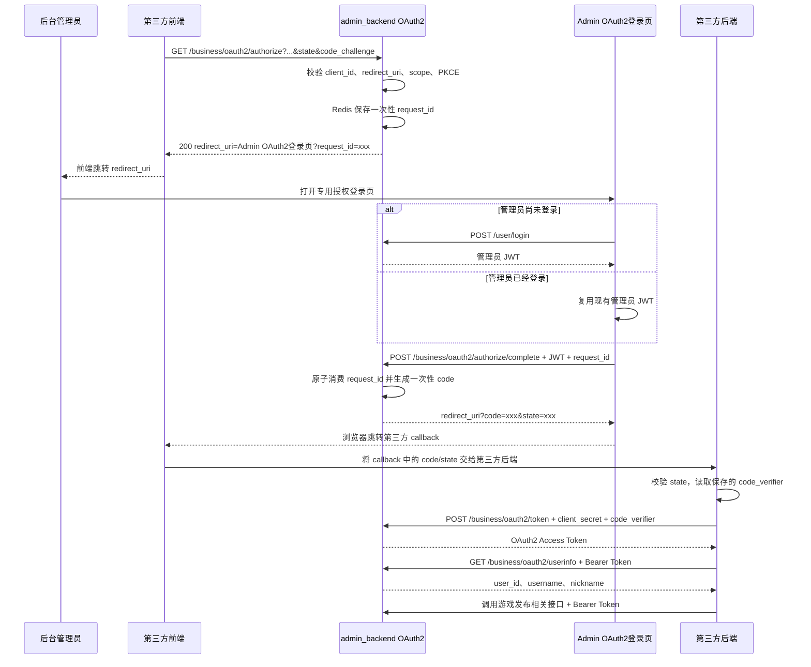

# Admin OAuth2 授权流程

本文档描述第三方平台通过后台管理员账号完成 OAuth2 Authorization Code + PKCE 授权、获取管理员信息并调用游戏发布相关接口的完整流程。

## 参与方

| 参与方 | 职责 |
| --- | --- |
| 第三方前端 | 发起浏览器跳转、接收第三方 callback 页面，不保存 `client_secret` |
| 第三方后端 | 保存 `state`、PKCE `code_verifier`，使用授权码换 Token，并调用 UserInfo/业务接口 |
| `admin_backend` | OAuth2 Authorization Server，校验客户端、生成授权请求/授权码/Access Token |
| Admin OAuth2 登录页 | 专用的管理员授权登录恢复页面，登录后继续 OAuth2 流程，而不是进入 Dashboard |
| 后台管理员 | OAuth2 资源所有者，授权第三方以其管理员身份调用允许的接口 |

## 完整时序



## 详细流程

### 1. 第三方发起授权

第三方后端应先生成并保存：

- 随机 `state`
- PKCE `code_verifier`
- `code_challenge = BASE64URL(SHA256(code_verifier))`
- 本次请求使用的精确 `redirect_uri`

第三方前端请求：

```http
GET /business/oauth2/authorize
    ?response_type=code
    &client_id=adm_xxx
    &redirect_uri=https%3A%2F%2Fpartner.example.com%2Foauth%2Fcallback
    &scope=game.publish
    &state=random_state
    &code_challenge=xxx
    &code_challenge_method=S256
```

`admin_backend` 将校验：

- OAuth2 Client 已启用
- `redirect_uri` 与客户端白名单精确匹配
- `scope` 在客户端允许范围内
- `response_type=code`
- PKCE 只允许 `S256`

校验成功后，服务端在 Redis 保存一次性授权请求，并直接返回专用 Admin OAuth2 登录页地址：

```json
{
  "redirect_uri": "https://admin.example.com/oauth2/login?request_id=xxx"
}
```

第三方前端收到响应后自行跳转：

```js
window.location.assign(response.redirect_uri);
```

`request_id` 是不透明、短时有效且只能消费一次的随机凭证，不包含管理员身份或 `client_secret`。

### 2. Admin OAuth2 登录页完成管理员认证

Admin OAuth2 登录页可以复用普通后台登录页的表单组件和 `/user/login` 接口，但登录成功后的行为不同：

| 页面 | 登录成功后的行为 |
| --- | --- |
| 普通后台登录页 | 进入后台 Dashboard |
| Admin OAuth2 登录页 | 使用 `request_id` 继续 OAuth2 授权并返回第三方 |

如果管理员已经登录，页面可以直接复用现有管理员 JWT，无需再次输入账号密码。

登录完成后调用：

```http
POST /business/oauth2/authorize/complete
Authorization: Bearer <admin_jwt>
Content-Type: application/json
```

```json
{
  "request_id": "xxx"
}
```

服务端确认管理员仍处于启用状态，将其 `userId` 和 `roleId` 写入一次性授权码，并返回第三方 callback 地址：

```json
{
  "redirect_uri": "https://partner.example.com/oauth/callback?code=xxx&state=random_state"
}
```

Admin OAuth2 登录页执行：

```js
window.location.replace(response.redirect_uri);
```

当前流程不展示 consent 确认页，管理员登录成功后直接完成授权。

### 3. 第三方处理 callback

第三方 callback 页面收到：

```text
https://partner.example.com/oauth/callback?code=xxx&state=random_state
```

第三方必须：

1. 将 callback 参数交给自己的后端处理。
2. 校验 `state` 与发起授权时保存的值完全一致。
3. 从服务端会话中读取对应的 `code_verifier`。

### 4. 第三方后端换取 Access Token

`client_secret` 只能保存在第三方后端，禁止写入浏览器代码、URL、LocalStorage 或前端构建产物。

```http
POST /business/oauth2/token
Authorization: Basic base64(client_id:client_secret)
Content-Type: application/x-www-form-urlencoded

grant_type=authorization_code&code=xxx&redirect_uri=https%3A%2F%2Fpartner.example.com%2Foauth%2Fcallback&code_verifier=xxx
```

响应示例：

```json
{
  "access_token": "xxx",
  "token_type": "Bearer",
  "expires_in": 86400,
  "scope": "game.publish"
}
```

授权码、OAuth2 登录恢复请求均只能使用一次。

### 5. 获取管理员信息

第三方后端使用同一个 OAuth2 Access Token 请求：

```http
GET /business/oauth2/userinfo
Authorization: Bearer <access_token>
```

响应示例：

```json
{
  "user_id": "administrator_uuid",
  "username": "admin",
  "nickname": "Administrator",
  "scope": "game.publish"
}
```

当前方案不会额外签发“用户信息 Token”。同一个 Access Token 用于访问 `/business/oauth2/userinfo` 和授权范围内的业务接口。

### 6. 调用游戏发布相关接口

同一个包含 `game.publish` scope 的 OAuth2 Access Token 可以调用以下接口：

| 方法 | 路径 | 作用 |
| --- | --- | --- |
| `POST` | `/business/game/set` | 发布或设置游戏 |
| `POST` | `/business/game/class/list` | 获取游戏分类列表 |
| `GET` | `/business/tag/list` | 获取标签列表 |

例如发布游戏：

```http
POST /business/game/set
Authorization: Bearer <access_token>
Content-Type: application/json
```

这三个接口都兼容后台管理员 JWT 和 OAuth2 Bearer Token。OAuth2 Token 必须包含 `game.publish` scope；该 scope 只限制客户端能力，最终是否允许访问仍由管理员 `roleId` 对应的现有 Casbin 权限决定。

## 接口作用

| 接口/页面 | 调用方 | 认证方式 | 作用 |
| --- | --- | --- | --- |
| `GET /business/oauth2/authorize` | 第三方前端 | 无 | 发起授权，校验 OAuth2 参数并返回 Admin OAuth2 登录页地址，由前端自行跳转 |
| Admin `/oauth2/login` | 后台管理员浏览器 | Admin 前端登录态 | 专用登录恢复页面，保存 `request_id` 并继续授权流程 |
| `POST /user/login` | Admin OAuth2 登录页 | 管理员账号密码及现有登录校验 | 获取管理员 JWT；接口本身与普通后台登录共用 |
| `POST /business/oauth2/authorize/complete` | Admin OAuth2 登录页 | 管理员 JWT | 绑定管理员身份、原子消费 `request_id`、生成授权码 |
| 第三方 `redirect_uri` | 浏览器 | `code` + `state` | 接收授权结果并交给第三方后端 |
| `POST /business/oauth2/token` | 第三方后端 | `client_id` + `client_secret` + PKCE | 使用 form-urlencoded 请求体和一次性授权码换取 Access Token |
| `GET /business/oauth2/userinfo` | 第三方后端 | OAuth2 Bearer Token | 获取管理员 ID、用户名、名称和 scope |
| `POST /business/game/set` | 第三方后端 | 管理员 JWT 或 OAuth2 Bearer Token | 发布游戏；OAuth2 Token 需要 `game.publish` |
| `POST /business/game/class/list` | 第三方后端 | 管理员 JWT 或 OAuth2 Bearer Token | 获取游戏分类列表；OAuth2 Token 需要 `game.publish` |
| `GET /business/tag/list` | 第三方后端 | 管理员 JWT 或 OAuth2 Bearer Token | 获取标签列表；OAuth2 Token 需要 `game.publish` |
| `POST /business/oauth2/revoke` | 第三方后端 | OAuth2 Client 认证 | 使用 form-urlencoded 请求体主动撤销尚未过期的 Access Token |

## 配置

OAuth2 Access Token 必须使用独立签名密钥，不能复用后台管理员 JWT 密钥：

```dotenv
ADMIN_OAUTH2_ACCESS_SECRET=<至少32字节的随机密钥>
```

Admin OAuth2 登录恢复页面地址：

```yaml
OAuth2:
  AdminAuthorizeURL: "http://localhost:5667/#/auth/login"
```

不同环境直接在对应的 `core.yaml` 或 ConfigMap `config.yaml` 中配置实际地址，不再通过环境变量注入。

对应的 Admin 前端路由需要读取 `request_id`，登录后调用 `/business/oauth2/authorize/complete`，并跳转接口返回的 `redirect_uri`。

## 本地第三方演示页

仓库提供了一个纯静态演示页：

```text
services/admin_backend/api/docs/oauth2_partner_demo.html
```

在仓库根目录启动静态服务器：

```bash
python3 -m http.server 8088 --directory services/admin_backend/api/docs
```

浏览器访问：

```text
http://127.0.0.1:8088/oauth2_partner_demo.html
```

创建 OAuth2 Client 时，需要把同一个地址加入 `redirect_uris` 白名单。演示页会在浏览器中完成 PKCE、`state` 校验、Token 交换、UserInfo、业务接口调用和 Token 撤销。

为了模拟第三方后端并避免每次刷新后重新输入，演示页会在浏览器 `localStorage` 中保存 `client_secret`；PKCE、授权状态和 Access Token 仍保存在当前标签页的 `sessionStorage`。这仅适用于本地或受控测试环境，测试完成后应使用页面上的清理按钮删除敏感数据。正式接入时，`client_secret`、授权码换 Token 和 Token 撤销必须放在第三方后端。

## 安全约束

- `redirect_uri` 必须精确匹配客户端白名单，禁止模糊匹配。
- PKCE 强制使用 `S256`。
- `state` 必须由第三方生成并在 callback 时校验。
- `client_secret` 只能保存在第三方后端。
- 授权请求和授权码均保存在 Redis，并且只能原子消费一次。
- OAuth2 Access Token 使用独立签名密钥，并携带 `client_id`、`userId`、`roleId` 和 scope。
- 禁用 OAuth2 Client 后，其尚未过期的 Token 也会被接口拒绝。
- Access Token、授权码和包含登录/回调地址的 OAuth2 响应禁止被缓存。
